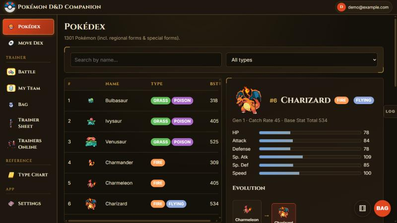
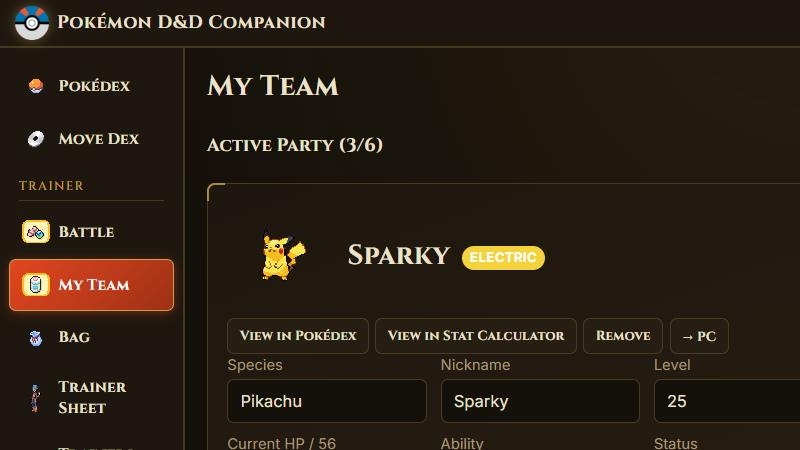

<div align="center">

# Pokémon D&D Companion

**A tabletop companion for Pokémon D&D: Pokédex, calculators, trainer sheets and live multiplayer with a DM Control Centre.**




</div>

## Features

**For players**
- Pokémon campaigns have no sidebar: the Hub is home. Beside its title, a bar holds My Team, Bag, Trainer, the Dex
  (Pokédex and Move Dex in one pull-out) and the stat calculator; the Whiteboard and Control Centre buttons sit just left of the "N here" pill;
  the "N here" pill drops down the trainers online; your team sits bottom left with each Pokémon's health (drag one
  onto the board). The Rulebook, Type Chart, Move Tier Guide and Library are pull tabs beside the log (drag a panel's
  edge to resize it), and the top bar's home button comes back
- On the hub your trainer sits above your team (portrait, name, money): click it for the Trainer page, or drag it onto the
  board for a card with your character's details. Team Pokémon dragged onto the board show their health and moves; Dex
  Pokémon given a level show their stats at that level. The Bag is a drop-down: drag any item (your money is a Key Item)
  onto the board, or drag a team Pokémon or an item onto Send To (bottom right) to give it to any player in the campaign,
  saying how many when you have more than one. Gifts land in the other player's save next time their hub checks in.
  Clicking a Pokémon, item, encounter or prop gives a little bounce and burst; the stars drift slowly and a comet goes by
  now and then. The eraser removes things you drag it across and highlights what it's over; other players' cursors and strokes move
  smoothly as they draw
- The hub's minimap (top left) shows the map the DM puts on the hub, centred on you, with only the places they've made
  visible. Drag it to look around; the button beside it brings it back to you. Click it for the full map: zoom, pan, a
  legend of places and players, and drag your own token to move. With fog of war on, the map is hidden in mist that
  clears where you go (shared between everyone, or each player's own, as the DM chooses)
- Battles: on your turn choose FIGHT, BAG, POKÉMON (switch), RUN or OTHER (describe anything else). The choice is
  final: a move's damage lands straight away, and your menu waits until the DM clicks Next Turn
- The Hub: a shared whiteboard every player lands on, with notes, drawings and everyone's cursor live (in each player's
  own colour, picked in Settings > Appearance, with their name above it). The DM drags encounter buttons onto it, and
  they are the only way into the Battle screen. Pings (P or Alt+click) point something out to everyone, notes can be
  recoloured and resized, the corner buttons zoom and fit the board, clicking a player's avatar jumps to them, and
  Ctrl+Z takes back what you last added. Shapes (box, circle, line, arrow) and a prop library (trees, rocks, buildings,
  chests and more) are in the tool bar. The board has a soft edge a little way past its content, which moves out as
  things are placed near it, so you can't get lost in empty space; a soft white mist gathers as you near it. Text is typed straight onto the board. The DM can fade in one of their maps,
  blurred, as the hub's backdrop. On the hub the app's top bar becomes round buttons (menu, theme, Settings, account),
  and Settings lives behind the gear there rather than in the Pokémon sidebar. Without a backdrop the hub is "cosmic",
  with twinkling stars. The Pokédex and Move Dex slide out from the hub's left edge, and any Pokémon or move can be
  dragged onto the board as a card (it asks for a level, which you can skip; your own team keeps theirs). The stars drift with a slight parallax as you pan, and the board starts roomy. Pinging can target a note, card or button: hover to highlight it, click to ripple
  round it. The Campaign Planner and Library are buttons down the hub's right-hand side, and the planner shares the
  hub's dark glass look (new boards start on the "Cosmic" background)
- Styled after vvd.world (studied with the Taste skill): white text at fixed opacities, glass panels with hairline
  borders instead of shadows, white pill buttons, serif titles that blur in when a page opens
- A separate phone layout (automatic on phones, or Settings -> Appearance -> Phone layout), built on Apple's interface
  guidelines: the hub's tools and pages sit on one radial wheel (tap the dot, spin the ring to bring other options
  round, with momentum and a soft stop at each end), panels are bottom sheets you drag down to close, two fingers pinch
  to zoom the board, and everything stays clear of the notch and home indicator with 44pt touch targets. The white
  dot stays in place on every page (elsewhere it takes you back to the hub) and glides between pages
- Dragging things on the hub: they dip when pressed, lift and lean with their speed, leave a fading trail in their
  colour, and settle with a spring when let go
- Pokédex and Move Dex covering 1301 Pokémon, with forms, evolutions and stats
- Stat calculator that loads your saved Pokémon
- My Team, Bag and Trainer Sheet built from the rulebook, with named saves
- Graphical battle view with synced multiplayer battles

**For the DM**
- Control Centre laid out like the hub: big options for Overview, Battle Control, Players, NPC Library and Wild Library
  (plus DM Tools for directives, gifts and notes). The Overview is one live board of everything: the battle (phase,
  round, whose turn, their choice, every combatant's health), every trainer's Pokémon, held items, bag and money (away players
  marked Offline, from their last save), player messages (dismiss them there) and the battle log
- Battle Control: the battle itself in the middle, seen from whoever's turn it is; on an NPC's or wild Pokémon's turn
  the DM plays it from the same menu players use. Phase, round and Next Turn sit above it; Add, Roster and Setup pull
  out from the left; DM Control (below) has the full console
- DM notes on the hub (DM note, beside Encounters): notes only the DM sees; the server never sends them to players.
  Pokémon campaigns have no Notebook on the Whiteboard; these notes replace it
- New players name their character before they first come into a Pokémon campaign
- New Whiteboard nodes grow to fit all their text
- The Whiteboard's Map editor (a full page: maps and labels on the left, the map in the middle, the hub, fog, players
  and markers on the right): put a map on the hub, make places visible, place players and markers, and turn on the
  fog of war (shared or private, how far players see, brush the mist away, cover it again)
- The Whiteboard has a Dex button too: drag a Pokémon out of it onto the board or into a Team slot, give it a level,
  and it is generated with the moves it knows by then
- SOUND and PARTY pull tabs (DM only, lower down the right edge): the music board and sound
  effects, and every trainer's Pokémon with health, status, ability, item, moves and bag (also the Control Centre's
  Players tab)
- Hub encounter buttons: an NPC trainer or wild Pokémon from the libraries, or an encounter rolled in the Campaign
  Planner. Hovering shows the first Pokémon's level, with its sprite or a question mark (the DM chooses); the DM's click
  starts that battle with every online trainer's lead Pokémon and opens Battle Control
- Per-campaign invite code; DM access is given and taken away by the owner (Settings -> Members), and the owner is always a DM. Taking it away closes that person's DM tools straight away
- Mystery Eggs: the DM gives one from Control Centre -> DM Tools with a Pokémon inside that only the server knows; it sits in the player's Key Items until they hatch it at level 1
- Moves are checked: a Pokémon can only know moves it learns by level up at or below its level, or egg moves
- Hub sounds: soft, spatial Web Audio sounds for clicks, drags, drops and pings (Settings -> Appearance -> Hub sounds)
- Each kind of bag item has its own sound when you drag it out (Poké Ball, medicine, TM, held item, key item, berry,
  money, egg); a Pokémon dragged out of the Pokédex or your team plays its real cry from the games.
- A trainer's own Pokémon cards show the whole sheet: HP, status, ability, held item and every move's numbers; open one
  for what the ability, item, status and moves do, and its stats.
- Whiteboard encounters scale to the party: a trainer, gym leader (+2) or wild encounter spawns at the players' average
  Pokémon level, a little higher the more players there are (+1.5 each after the first, up to +8). Each trainer, gym
  leader and wild card has a Level box; changing it re-levels the team around it (e.g. 15 -> 14 and 16) and gives
  generated Pokémon the moves they'd know at that level.
- Audio (Settings -> Appearance -> Audio): sound on/off and sliders for Master, Sound effects, Ambience and Pokémon
  (cries). Pokémon campaigns play a slow, spatial background soundscape (js/ambience.js). Placing hub encounters and
  cards, and everything on the Whiteboard (adding, moving, removing, snapping into slots, linking, re-rolling,
  re-levelling), has its own sound and a short animation.
- Catching: a thrown ball rolls a d20 on screen (with the ball wobbling and a caught / broke-free sound). The chance
  comes from the Pokémon's catch rate, its HP, its level (low levels are easier, high levels harder), its status and
  the ball. A player's throw carries the ball and target; the DM rolls it from Battle Control's top bar.
- Page changes blur and fade out, then the new page fades in from a blur, with a soft sound. Whiteboard nodes each
  have their own sound when placed, picked up or dropped (notes, stickies, checklists, trainers, gym leaders, wild
  Pokémon, dungeons...).
- Battle bench: each combatant is out on the field or on the bench (the roster's Out box). A player's first Pokémon goes
  out and the rest wait; the other side sends out everything. Players pick their lead on the VS screen, switch in a
  benched Pokémon from POKÉMON (it uses their turn), and send out the next one for free when one faints. The DM can
  switch NPC trainers' Pokémon the same way, and plays their own trainer's Pokémon from Battle Control when they're in
  the battle too.
- Battle: every move plays a short game-style animation with sound, picked by its type (fireballs, a water stream, a
  lightning bolt, falling rocks, psychic rings...). Physical moves lunge, special moves fly or beam across, status
  moves glow; everyone in the battle sees it.
- Map editor: its own page (the map button on the hub, left of the Whiteboard)
- The cosmic sky has Rayquaza as a constellation; the sign-in page is always in the cosmic theme

**Dungeons & Dragons 5e** (pick it when you create a campaign)
- Character builder and a full sheet: abilities, skills, saves, HP and death saves, spell slots and spellbooks, inventory and encumbrance, features and choices, level-up and rests, multiclassing
- SRD 5.1 (2014) and SRD 5.2 (2024) compendia: spells, monsters, equipment, magic items, classes, races/species, backgrounds, feats and rules text
- Dice roller with macros; live party view; initiative and combat tracker the DM can publish to players
- The DM can share a map with the table, reveal places one by one and place the players on it; whiteboard nodes link to places on maps, and each session can be viewed on its own
- The D&D rules version (2014 or 2024) is chosen by the campaign owner for the whole table (when creating the campaign, or in Settings > Campaign), so players never end up on different books
- Rule keywords anywhere (conditions, skills, damage types, racial traits...) link to their Rules entry with a hover card, and are coloured and bold on the Rules page; the character builder saves your progress so you can continue later
- DM screen, encounter builder with XP budgets, and campaign notes

**Everywhere**
- Whiteboard (both games; once the Campaign Planner): one full-screen board, no tower behind it. A bar at the bottom adds nodes (notes, checklists, stickies, expandable dungeons with per-room notes, and every generator: Pokémon wild encounters, trainers, gym leaders, routes; D&D NPCs, encounters, taverns, loot...). Drag them around an endless board that grows as you near its edge, change or upload the background, and circle groups of nodes (box or freehand) into colour-coded "Session N" regions; a node can be in several sessions. The Notebook drawer holds searchable Markdown notes that can also be NPCs, quests (with status), locations and session recaps, with an export to Markdown (it replaces the old Campaign Notes page and imports its notes once). Maps, scenarios (DM) and party plans (DM) open as drawers. Players share their boards, notes and checklists with the DM automatically. In Pokémon campaigns, trainer, gym leader and wild encounter nodes have Trainer and Team slots like Scratch blocks: bring the DM's NPC trainers and wild Pokémon in with the Libraries button and drag them in (a trainer gives the node its name, sprite and team; Pokémon join the team, up to six, and can be dragged to reorder or back out). The hub battles those exact teams. Trainers and gym leaders can have a portrait, shown on the Whiteboard and on their
  hub button. (The Campaign Planner is now called the Whiteboard; its add bar is at the bottom middle, like the hub's.)
- Library: add your own PDF, EPUB, Word, text, Markdown and HTML books and read them in a built-in e-reader (they stay on your device; accounts the admin allows keep them on the server, private, on every device they sign in on)
- Maps are stored on the server, so they follow you to every device: up to 10 per campaign (15 MB each) for everyone, unlimited (100 MB each) for accounts the admin allows
- Cosmic theme: every Pokémon D&D page uses the hub's look (deep space, glass cards, white pill buttons); D&D campaigns keep the device's theme choice
- Lava Tower theme for D&D campaigns (flame button in the top bar, or Settings → Appearance): grey brick tower, lava drips, cracks of light and crumbling stone; "Calm" turns the motion off
- Pokémon D&D Rulebook page, rendered from the Obsidian vault. In Pokémon campaigns the Rulebook and the Type Chart are
  also pull tabs (RULES, TYPES) on the right edge beside LOG, so they open over any page

**Online**
- Accounts with email, Google or Apple sign-in; campaigns appear after login
- Signing in with a password on a new device asks for a 4-digit code sent to the account's email
- Admin console for the site owner: every account and campaign, storage and disk use, permission switches, and a
  command line (`grant`, `revoke`, `perms`, `signout`, `who`); deleting a campaign there moves it to a restorable
  "Deleted campaigns" list instead of erasing it
- Autosave, hourly backups and automatic recovery
- Trainers Online with live presence

**On any device**
- Tuned for 1920×1080, 3440×1440 and iPhone
- `/` focuses search, `Esc` closes floating panels

<p align="center"></p>

## Quick start

```bash
python server.py            # then open http://localhost:8850
python -m unittest discover -s tests -v    # server tests
node --test tests/js/*.test.mjs            # D&D rules engine (Node 20+)
```

To try a branch or fork without touching real saves: `python tools/test_server.py [folder]` runs it on port 8860 with its own empty data (`--lan` for your phone, `--reset` to start fresh). `python tools/seed_test_campaign.py` then fills that test server with a DM, seven players with 3rd-level characters and personal motives, and a twelve-session planner (three played), and `node tools/keep_table_online.mjs` keeps the seven players showing as online in Party. For demos, `python tools/seed_showcase.py` builds the same campaign run long: eight 7th-level characters, 12 of 24 sessions played, homebrew, saved encounters, a published fight, a party map, battle-log rolls and messages to the DM (`--base <url> --live` to put it on a real server; `keep_table_online.mjs --showcase` keeps those players online). For a Pokémon table, `python tools/seed_pokemon_campaign.py` builds "The Aurora Circuit" on the test server: a DM and eight players with full trainer sheets, six Pokémon each plus a PC, bags, personal motives and planners, the DM's NPC and Wild Libraries, a ten-session Whiteboard (three played), a laid-out hub, a fogged region map, a live battle with benches, eggs, gifts and a co-DM (world built by `tools/seed_pokemon_world.mjs`; safe to re-run). Seed passwords stay outside the repo, in your home folder.

No packages to install and no build step: the server is standard-library Python and the front end is plain ES modules.

## Hosting

Bind to loopback behind an HTTPS proxy and configure through environment variables such as `PKDND_BIND`, `PKDND_BACKUP_DIR` and `PKDND_GOOGLE_CLIENT_ID`. See [docs/hosting.md](docs/hosting.md).

## Project layout

```
server.py        API, campaigns, accounts, autosave, backups
auth.py          password hashing, Google/Apple token verification
index.html       app shell
js/              router, network client, views, per-game systems
css/             style.css (base), dnd5e.css, library.css, lava.css + generated lava-bricks.css
data/            rules data
tools/           data and sprite download scripts, export_dnd5e.py (SRD data), export_rulebook.py (vault -> JSON), make_brick_tiles.py
desktop/         optional desktop-window build (not used by the live site)
sprites/         Pokémon art (from PokeAPI, see sprites/README.md)
tests/           server test suite (Python) and rules-engine tests (tests/js)
docs/            hosting, security, notes
```

## Security

The server trusts the signed-in session, never an id sent by the browser. Only an allowlist of static folders is served, and the save file is never reachable. See [docs/security.md](docs/security.md).

## Documentation

- [docs/architecture.md](docs/architecture.md): the shell and game-system split
- [docs/hosting.md](docs/hosting.md): running and deploying
- [docs/security.md](docs/security.md): the security model
- [CLAUDE.md](CLAUDE.md) and [docs/claude-project.md](docs/claude-project.md): working on this with Claude
- [docs/guide.md](docs/guide.md): the original long-form notes (historical)

## Third-party material

- D&D rules data: the 5e-database project, from the System Reference Document 5.1 and 5.2 by Wizards of the Coast, licensed CC-BY-4.0 (attribution is shown in the app). Refresh with `python tools/export_dnd5e.py`.
- PDF.js (Mozilla, Apache-2.0) is vendored unmodified in `js/vendor/pdfjs/` for the Library's PDF reader.

## Disclaimer

An unofficial fan project, not affiliated with or endorsed by Nintendo, Game Freak, The Pokémon Company or Wizards of the Coast. Pokémon and its characters are trademarks of their owners. Species data comes from [PokeAPI](https://pokeapi.co). The code and the Pokémon D&D rules are by the author and released under the [MIT license](LICENSE); All Pokémon art is provided by PokeAPI and originates from Nintendo, Game Freak and The Pokémon Company ([details](sprites/README.md)); it stays their property and is not covered by the license.
