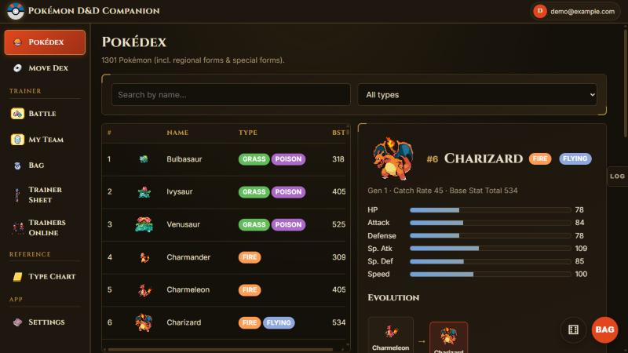
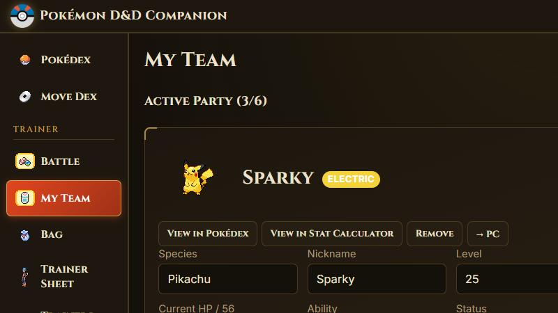

<div align="center">

# Pokémon D&D Companion

**A tabletop companion for Pokémon D&D: Pokédex, calculators, trainer sheets and live multiplayer with a DM Control Centre.**




</div>

## Features

**For players**
- Pokédex and Move Dex covering 1301 Pokémon, with forms, evolutions and stats
- Stat and Damage calculators that load your saved Pokémon
- My Team, Bag and Trainer Sheet built from the rulebook, with named saves
- Graphical battle view with synced multiplayer battles

**For the DM**
- Control Centre with directives, NPC and wild libraries, messaging and logs
- Per-campaign invite code and DM password

**Dungeons & Dragons 5e** (pick it when you create a campaign)
- Character builder and a full sheet: abilities, skills, saves, HP and death saves, spell slots and spellbooks, inventory and encumbrance, features and choices, level-up and rests, multiclassing
- SRD 5.1 (2014) and SRD 5.2 (2024) compendia: spells, monsters, equipment, magic items, classes, races/species, backgrounds, feats and rules text
- Dice roller with macros; live party view; initiative and combat tracker the DM can publish to players
- DM screen, encounter builder with XP budgets, generators (NPCs, taverns, loot, weather) and campaign notes

**Everywhere**
- Library: add your own PDF, EPUB, Word, text, Markdown and HTML books and read them in a built-in e-reader (they stay on your device)
- Lava Tower theme (flame button in the top bar, or Settings → Appearance): grey brick tower, lava drips, cracks of light and crumbling stone; "Calm" turns the motion off
- Pokémon D&D Rulebook page, rendered from the Obsidian vault

**Online**
- Accounts with email, Google or Apple sign-in; campaigns appear after login
- Autosave, hourly backups and automatic recovery
- Trainers Online with live presence

**On any device**
- Tuned for 1920×1080, 3440×1440 and iPhone
- `/` focuses search, `Esc` closes floating panels

<p align="center"></p>

## Quick start

```bash
python server.py            # then open http://localhost:8850
python -m unittest discover -s tests -v    # server tests
node --test tests/js/*.test.mjs            # D&D rules engine (Node 20+)
```

To try a branch or fork without touching real saves: `python tools/test_server.py [folder]` runs it on port 8860 with its own empty data (`--lan` for your phone, `--reset` to start fresh).

No packages to install and no build step: the server is standard-library Python and the front end is plain ES modules.

## Hosting

Bind to loopback behind an HTTPS proxy and configure through environment variables such as `PKDND_BIND`, `PKDND_BACKUP_DIR` and `PKDND_GOOGLE_CLIENT_ID`. See [docs/hosting.md](docs/hosting.md).

## Project layout

```
server.py        API, campaigns, accounts, autosave, backups
auth.py          password hashing, Google/Apple token verification
index.html       app shell
js/              router, network client, views, per-game systems
css/             style.css (base), dnd5e.css, library.css, lava.css + generated lava-bricks.css
data/            rules data
tools/           data and sprite download scripts, export_dnd5e.py (SRD data), export_rulebook.py (vault -> JSON), make_brick_tiles.py
desktop/         optional desktop-window build (not used by the live site)
sprites/         Pokémon art (from PokeAPI, see sprites/README.md)
tests/           server test suite (Python) and rules-engine tests (tests/js)
docs/            hosting, security, notes
```

## Security

The server trusts the signed-in session, never an id sent by the browser. Only an allowlist of static folders is served, and the save file is never reachable. See [docs/security.md](docs/security.md).

## Documentation

- [docs/architecture.md](docs/architecture.md): the shell and game-system split
- [docs/hosting.md](docs/hosting.md): running and deploying
- [docs/security.md](docs/security.md): the security model
- [CLAUDE.md](CLAUDE.md) and [docs/claude-project.md](docs/claude-project.md): working on this with Claude
- [docs/guide.md](docs/guide.md): the original long-form notes (historical)

## Third-party material

- D&D rules data: the 5e-database project, from the System Reference Document 5.1 and 5.2 by Wizards of the Coast, licensed CC-BY-4.0 (attribution is shown in the app). Refresh with `python tools/export_dnd5e.py`.
- PDF.js (Mozilla, Apache-2.0) is vendored unmodified in `js/vendor/pdfjs/` for the Library's PDF reader.

## Disclaimer

An unofficial fan project, not affiliated with or endorsed by Nintendo, Game Freak, The Pokémon Company or Wizards of the Coast. Pokémon and its characters are trademarks of their owners. Species data comes from [PokeAPI](https://pokeapi.co). The code and the Pokémon D&D rules are by the author and released under the [MIT license](LICENSE); All Pokémon art is provided by PokeAPI and originates from Nintendo, Game Freak and The Pokémon Company ([details](sprites/README.md)); it stays their property and is not covered by the license.
